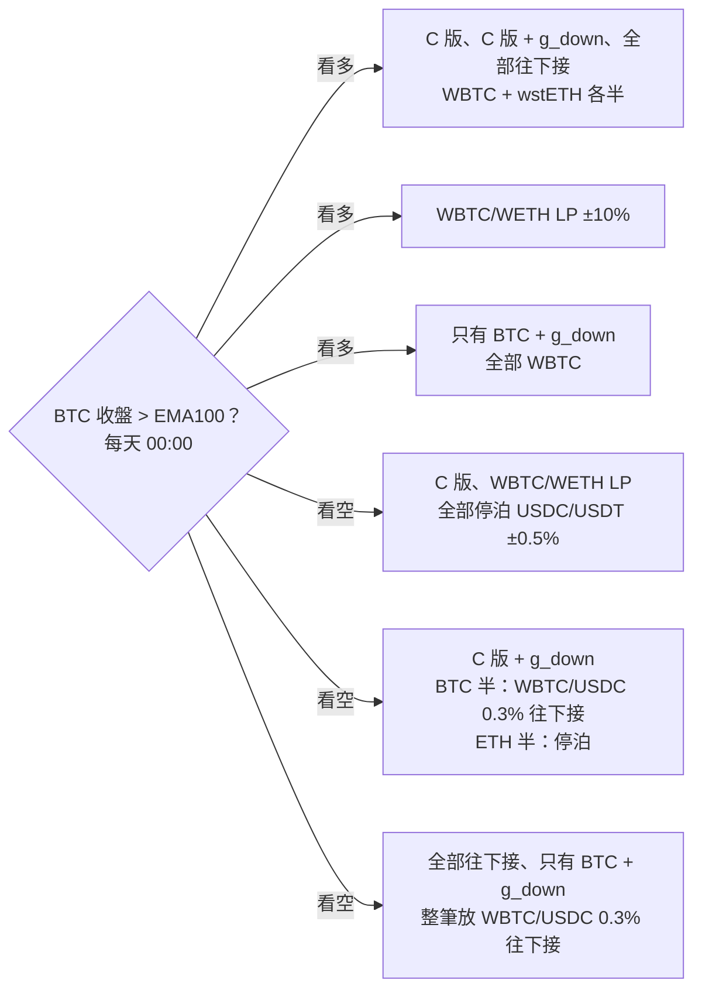

# 2026-10-12 這週的回測報告：H17～H36

日期：2026-10-13
計畫：[單幣計畫](plan_2026-10-12_single_coin.md)、[雙幣計畫](plan_2026-10-12_two_coin.md)（每一項的做法、判定和完整結果都在這兩份裡）
前一份：[single_pool_loop.md](single_pool_loop.md)（H1～H16，以及 g_down 第一次出現的 H4b）

## 摘要

- **BTC 的 g_down 又多過了 6 關。** 分 3 份時間（H20）、晚 1 小時下單（H25）、每天只檢查一次（H26）、參數平面（H27）都通過；濾網平移（H24）說明濾網的時機是主要來源；上線候選版本（H33）在 $10k、$100k、$1M 都是正的。
- **⚠️ 但增益的大小不能看得太準。** 平移濾網後的安慰劑中位數也有 +6.6%（真實濾網 +10.6%），不重疊的資料重抽後 90% 區間包含 0（H28），只換重放的時間表中位數就差 7 pt（H35）。
- **⚠️ 放進上線版本整體看，報酬多、回撤也更深。** C 版加上 BTC 那一半的 g_down，2022-01～2026-09 多 +59.9 pt，但最深的回撤差 4.6 pt（H34，不通過）。
- **❌ ETH 往下接結案。** 0.05%、0.3%、Arbitrum 三個池子都不成立（H18-A、H31、H22R），兩個幣都往下接也不通過（H32）。
- **❌ WBTC/WETH LP 結案。** 置中（H23）、偏一邊（H29）、分份（H30）都大輸給 50/50 現貨，2024～2025 年 BTC 大幅強過 ETH 時尤其嚴重。
- **❌ 比值的 g_down 沒有重現。** 2022～2024 年 8/8（H21），2024-10 以後只有 1/5（H21R）。
- **同一本帳比（3.3 節，描述性）**：WBTC/WETH LP 收了 +140.8 pt 手續費，但無常損失 −181.4 pt；g_down 買單手續費 +111.3 pt、無常損失 −70.8 pt。事後追加的「只有 BTC + g_down」+333.6%、回撤 −43.1%，「C 版 + 看空全部往下接」+323.7%、回撤 −50.5%，都沒有事先登記。

## 1. 這週怎麼做

流程照 `single_pool_loop.md`：每一項先把判定條件寫進計畫並 commit，再到 backtest 機器上跑，結果寫回計畫。

### 1.1 執行紀錄

| 日期 | 內容 |
|---|---|
| 10-12 10:35～21:17 | H17～H32 一個佇列跑完（3 個 worker） |
| 10-13 上午 | H33（候選版本，窗口框架） |
| 10-13 中午～下午 | H35、H36（重放規則），H34（候選版本整體跟 C 版比） |

### 1.2 過程中的問題（都已寫進各項的修改紀錄）

- **H29 第一次中斷**：3 個 worker 同時讀同一個快取檔，32 條 LP 指數只跑完 2 條。加上重試（`d15b6c4`）後重跑。
- **佇列記下的結束碼是錯的**：先執行 `date` 才讀結束碼，所以永遠是 0。每一步的 log 都逐一檢查過。
- **H32 的結果在 commit 登記之前就看到了**：程式測試時，H31 已經跑完，測試直接算出正式結果。判定條件是先寫好的，沒有改。
- **H34 第一次用分鐘資料把機器的記憶體用光**：每條 4 年多的連續回測要 4～5 GB，系統強制停掉程式 6 次，12 條完成 0 條。改用小時資料（`1cffd8a`），改之前先確認小時資料跟分鐘資料在 H26 的 2 個窗口只差 +1.4、+1.9 pt。

## 2. 站得住的：BTC 的 g_down

g_down：BTC 濾網（`0x99ac` 的 EMA100）看多時持有 WBTC，看空時在 `0x99ac`（WBTC/USDC 0.3%）放一排往下接的買單 [p/1.40, p×1.01]。對照組 g_spot100 是同一個濾網、看空時全部 USDC。

| 檢查 | 結果 | 判定 |
|---|---|---|
| H4b 原始結果（前一份） | +10.6%（中位數，16 個 12 個月窗口），14/16 > 0 | 通過 |
| H20 分 3 份時間（00/08/16 時） | **+8.8%**，14/16；3 個時間點只差約 2.8 pt | ✅ |
| H20 每份 $33k、3 gwei | +8.9%，14/16 | ✅ |
| H24 濾網整段平移 20 次 | 只有 1/20 比真實濾網好；安慰劑中位數 +6.6%，19/20 是正的 | 濾網時機是主要來源 |
| H25 晚 1 小時下單 | **+10.9%**，14/16（晚 4 小時 +9.6%，只列出） | ✅ |
| H26 每天 00:00 才檢查出界，$100k | **+14.3%**，13/16，gas 中位數 0.36% | ✅ |
| H26 同上，$10k | **+10.0%**，13/16，gas 中位數 3.6% | ✅（$10k 在各年實際 gas 下第一次通過） |
| H27 參數平面 27 格 | 25/27 格中位數 > 0；上緣 p×1.01、p×1.03 的 18 格全部是正的 | 高原 |
| H28 不重疊資料重抽 | 年化 +7.5%，90% 區間 −4.2%～+20.7% | 區間包含 0 |
| H35 每 3 天 / 每週 / 不重放 | +7.4% / +9.5% / +12.6%，都通過 H2，但都比每天檢查低超過 1 pt | 維持每天檢查 |
| H36 跌破下緣不重放 | +12.1% | 維持重放 |

### 2.1 解讀

- **g_down 對換條件很穩**：時間點、延遲、檢查頻率、參數，換了都還是正的。
- **但數字本身雜訊很大**：濾網的時機大約貢獻 4 pt，另外約 6.6 pt 不管什麼時候放買單都會出現（H24）。2022～2026 這條價格路徑本身對往下接有利。
- **每天檢查比每小時檢查好**：gas 少很多，報酬不差，$10k 也能做。「不重放」只差 1.7 pt，$10k 時反而最好（+11.4%），鏈上操作最少，值得一起觀察。

## 3. 上線候選版本和取捨

### 3.1 H33：窗口框架 ✅

C1：BTC 那一半用每天檢查的 g_down，ETH 那一半照現行濾網持有現貨。C0：現行濾網，兩邊都是現貨。16 個 12 個月窗口，各半資金。

| 資金 | C1 − C0 中位數 | > 0 | 最大回撤中位數（C1 對 C0） |
|---|---|---|---|
| **$100k** | **+7.1%** | **13/16** | −32.7% 對 −32.4% |
| $10k | +5.0% | 13/16 | −32.0% 對 −31.7% |
| $1M | +4.8% | 13/16 | −36.4% 對 −37.6% |

最後 3 個窗口（2025-04、07、10 起點）都是負的：−3.1%、−4.1%、−1.2%。

### 3.2 H34：放進 C 版整體看 ❌

C 版是多池研究建議的上線版本：濾網分 3 份時間，ETH 以 wstETH 持有，看空時停泊 USDC/USDT，鏈上完整成本。這裡把整本帳分成 ETH、BTC 兩半，各自從 2022-01-01 開始、兩半之間不再平衡（跟正式 C 版的每次換邊再平衡略有不同），C+g 只把 BTC 那一半看空時的停泊改成 g_down。$100k、分 3 份：

| 版本 | 2022-01～2026-09 總報酬 | 最大回撤 | 2022 | 2023 | 2024 | 2025 | 2026 |
|---|---|---|---|---|---|---|---|
| 持有 BTC（不動） | +80.8% | | −64.4% | +155.9% | +120.7% | −6.2% | −4.2% |
| 持有 ETH（不動） | −26.9% | | −67.5% | +90.3% | +46.1% | −10.8% | −9.5% |
| 50/50（買進後不動；各年欄是每年 1 月 1 日重設） | +26.9% | | −65.9% | +123.1% | +83.4% | −8.5% | −6.9% |
| C | +210.4% | −37.1% | −7.8% | +63.2% | +61.3% | +20.6% | +5.9% |
| **C+g** | **+270.3%** | **−41.7%** | −6.1% | +69.1% | +76.8% | +24.1% | +6.1% |
| C+g − C | **+59.9 pt** | **−4.6 pt** | +1.7 | +6.0 | +15.5 | +3.5 | +0.2 |

- 判定要求回撤不差超過 2 pt，差了 4.6 pt，**不通過**。
- 小時資料讓 g_down 每年大約多算 1.5～2 pt，累積起來約佔 +59.9 pt 中的 10～15 pt。扣掉後報酬仍然明顯較好，但回撤的問題跟這個偏差無關。
- 回撤變深的原因：看空時 BTC 那一半在下跌途中接貨。H33 用 12 個月窗口的中位數看不出來，連續 4 年多的帳上，最差的那一次就深了 4.6 pt。
- $1M 單份時，BTC 那一半在 `0x99ac` 的價格衝擊太大，總報酬反而少 70.7 pt；分 3 份時多 14.8 pt，但回撤差 9.0 pt。$10k 在主網上連 C 版本身的 gas 都付不起（約 $9,700）。

**要決定的是取捨**：每年多幾個百分點，換最深的回撤多 4～5 pt。這不是回測能回答的。

### 3.3 同一本帳比各策略（描述性，2026-10-13 追加）

這一節把各策略放進同一本帳比：2022-01-01 開始，$100k，同一個濾網（`0x99ac` BTC EMA100，每天 00:00），分 1 份，扣換幣手續費、價格衝擊和各年 gas，每次濾網換邊拉回目標比例。它不重新判定任何假設。C 版 + g_down 是一本帳的近似（g_down 那一半用 $50k 的 Demeter 回測淨值當一個部位），跟 3.2 節 H34 的兩半、分 3 份算法不同，所以數字不一樣。最後兩個版本是看過結果之後才加的，**事後追加、只列出**。

往下接的區間是 [p/1.40, p×1.01]，一開始約 97% 是 USDC，價格往下時沿路買進 BTC；每天 00:00 出界就重放（H26）。

| 策略 | 總報酬 | 年化 | 最深回撤 | 移倉 | 濾網換邊 | gas |
|---|---|---|---|---|---|---|
| 持有 BTC（不動） | +80.8% | +13.3% | −67.6% | 0 | 0 | $0 |
| 持有 ETH（不動） | −26.9% | −6.4% | −76.8% | 0 | 0 | $0 |
| 50/50（買進後不動） | +26.9% | +5.1% | −69.7% | 0 | 0 | $0 |
| C 版 | +231.8% | +28.7% | −38.2% | 1 | 63 | $2,013 |
| WBTC/WETH LP（`0x4585` ±10%） | +151.8% | +21.5% | −39.3% | 25 | 63 | $2,849 |
| **C 版 + g_down** | **+279.8%** | **+32.4%** | **−44.5%** | 19 | 63 | $3,989 |
| 只有 BTC，看空停泊（事後追加） | +228.3% | +28.4% | −33.7% | 1 | 63 | — |
| 只有 BTC + g_down（事後追加） | +333.6% | +36.2% | −43.1% | 18 | 63 | $1,900 |
| C 版 + 看空全部往下接（事後追加） | +323.7% | +35.5% | −50.5% | 18 | 63 | $2,856 |

每年報酬（年底淨值 ÷ 前一年年底淨值）：

| 策略 | 2022 | 2023 | 2024 | 2025 | 2026（到 9/30） |
|---|---|---|---|---|---|
| 持有 BTC | −64.4% | +156.3% | +120.6% | −6.2% | −4.3% |
| 50/50 持有 | −65.9% | +124.9% | +90.6% | −7.6% | −5.9% |
| C 版 | −3.9% | +64.5% | +64.1% | +24.7% | +2.6% |
| WBTC/WETH LP | −2.7% | +65.9% | +46.1% | +2.6% | +4.0% |
| **C 版 + g_down** | +2.6% | +67.7% | +74.1% | +28.6% | −1.4% |
| 只有 BTC，看空停泊 | −4.4% | +81.3% | +73.0% | −0.1% | +9.6% |
| 只有 BTC + g_down | +9.7% | +89.8% | +94.4% | +6.6% | +0.5% |
| C 版 + 看空全部往下接 | +9.4% | +70.3% | +83.1% | +32.7% | −6.4% |

PnL 來源（整段加總，佔本金 $100k 的 pt）。每小時的淨值變化依當時的部位拆開，加總等於總報酬。每個 LP（WBTC/WETH LP、g_down 的買單、看空時的停泊池）都分成手續費和無常損失：每次放區間時，區間和幣量都知道，不含手續費的部位價值只由池子價格決定，持有放進去那些幣的漲跌算在幣價，不含手續費的部位減掉持有那些幣是無常損失，剩下的是手續費，置中當下的換幣成本算在成本。

| pt | C 版 | WBTC/WETH LP | C 版 + g_down |
|---|---|---|---|
| BTC 價格 | +102.1 | +95.0 | +114.4 |
| ETH 價格 | +131.2 | +107.9 | +154.5 |
| wstETH 質押 | +7.4 | — | +8.4 |
| **手續費** | +7.4（停泊池） | **+147.8**（LP +140.8、停泊池 +6.9） | **+115.5**（買單 +111.3、停泊池 +4.2） |
| **無常損失** | +0.1 | **−181.3** | **−70.7** |
| 成本 | −17.4 | −18.6 | −48.5 |
| 其他（未拆開） | +1.0 | +1.0 | +6.3 |
| 合計 | +231.8 | +151.8 | +279.8 |

- **WBTC/WETH LP 輸在無常損失**：LP 收了 +140.8 pt 手續費，無常損失 −181.4 pt，集中在 2024、2025 年（手續費 +33.1、+28.5 pt，無常損失 −45.1、−41.7 pt）。BTC 大幅強過 ETH 時，LP 一路賣出 BTC。
- **g_down 的手續費大過無常損失**：買單手續費 +111.3 pt，無常損失 −70.8 pt。g_down 的無常損失就是 BTC 下跌時接貨、接完繼續跌的損失。2026 年無常損失 −9.0 pt 大過手續費 +7.7 pt，第一次輸給 C 版。
- **看多只持有 BTC**：看空停泊時報酬跟 C 版差不多（+228.3% 對 +231.8%），回撤淺 4.5 pt；看空 g_down 時 +333.6% 對 +279.8%，回撤也淺 1.4 pt。但這段期間 BTC 本來就大幅強過 ETH（持有 +80.8% 對 −26.9%），只有 2025 年 ETH 漲、BTC 沒漲時明顯輸。
- **看空時全部往下接**：比 C 版 + g_down 多 +43.9 pt，最深回撤加深 6.0 pt 到 −50.5%，2026 年 −6.4%。
- 檢查：手續費裡只跟著價格走的部分，WBTC/WETH LP 約 4%，g_down 和停泊池都小於 1%。WBTC/WETH 的區間用 ±10% 近似、沒有對齊 tick，每小時有雜訊，按天加總後 1,734 天裡有 310 天是負的，整段加總會抵消。

## 4. 移倉與濾網換邊次數

移倉是把流動性從舊的部位移到新的部位：移除舊區間、在新的價格放新區間。濾網換邊是在現貨和 LP 或穩定幣之間轉換。兩者每次都要付 gas、換幣手續費和價格衝擊。

### 4.1 g_down 的移倉規則（$100k，每個 12 個月窗口的中位數）

| 版本 | 移倉次數 | 濾網換邊次數 | 減去 g_spot100 |
|---|---|---|---|
| **每天 00:00 檢查（H26）** | **4** | 15 | **+14.3%** |
| 每 3 天檢查（H35） | 3 | 15 | +7.4% |
| 每週檢查（H35） | 2 | 15 | +9.5% |
| 跌破下緣不移倉（H36） | 2 | 15 | +12.1% |
| 不移倉（H35） | 0 | 15 | +12.6% |
| 對照組 g_spot100 | 0 | 15 | 基準 |

濾網換邊次數只由濾網決定，每個版本都一樣：每個窗口中位數 15 次，最少 7 次、最多 24 次。

### 4.2 H34 每年的次數（BTC 那一半，3 份合計）

| 年 | g_down 移倉 | g_down 濾網換邊 | C 版停泊池移倉 | C 版換倉 |
|---|---|---|---|---|
| 2022 | 28 | 23 | 0 | 20 |
| 2023 | 2 | 45 | 1 | 45 |
| 2024 | 7 | 44 | 0 | 44 |
| 2025 | 6 | 49 | 0 | 49 |
| 2026（到 9/30） | 19 | 31 | 0 | 31 |

- g_down 的移倉集中在單邊下跌的年份（2022 年 28 次、2026 年 19 次）。
- C 版的停泊池是 USDC/USDT ±0.5%，有放錢的期間只在 2023 年 3 月 USDC 脫鉤時移倉過 1 次。C 版的換倉是 3 份中任一份換邊就算一次。

### 4.3 WBTC/WETH LP（2022-01～2026-09，整段）

| 版本 | 移倉次數 |
|---|---|
| H23 `0x4585` ±10% / ±20% | 40 / 14 |
| H23 `0xCBCd` ±10% / ±20% | 42 / 15 |
| H29 `0x4585` 順勢 / 逆勢（5/15、EMA100） | 119 / 159 |
| H29 `0xCBCd` 順勢 / 逆勢（5/15、EMA100） | 122 / 159 |

H29 的比值濾網翻轉時也要移倉，所以次數是置中版本的 3～4 倍。

## 5. 結案的方向

- **ETH 往下接**：H18-A（`0x88e6`，0.05%）中位數 −0.3%，後半 −17.7%；H31（`0x8ad5`，0.3%）−0.0%，後半 −5.1%；H22R（`0xc473`，Arbitrum 0.3%）−34.1%，主要是池子太薄、價格衝擊吃掉本金。2024 年以後 ETH 跌破濾網後一路往下，買單接滿。
- **兩個幣都往下接（H32）**：報酬過了（+4.1%，12/16），回撤差 2.8 pt，不通過。只有 BTC 往下接的版本是 +5.3%，14/16。
- **ETH 用自己的濾網（H18-C、H19）**：現貨本身比用 BTC 濾網差，中位數 −7.6%，5/16。
- **WBTC/WETH LP（H23、H23R、H29、H30）**：`0x4585` 上 L − B 是 −75.4 pt，`0xCBCd` 2022～2024-09 是 −18.9 pt，2024-10 以後 −35.9 pt。偏一邊（H29）順勢少 2.5～3.4 pt、逆勢少 9.1～36.8 pt。分份（H30）份數越多輸越多，因為每份都付 gas。LP 在 BTC 漲的過程中一路賣出 BTC。
- **比值的 g_down（H21、H21R）**：0.3% 的 `0xCBCd` 在 2022-01～2024-09 是 +2.6%、8/8，但跟 0.05% 的 `0x4585`（+2.9%）幾乎一樣；2024-10 以後只有 1/5 是正的，沒有重現。
- **同類資產 LP（H17、H18-B）**：cbBTC LP 中位數 +0.01%，經濟上等於 0；wstETH/WETH LP 比持有 wstETH 多 +0.44%，9/10。都通過，但金額很小。

## 6. 限制

- **一條價格路徑**：所有結果都來自 2022-01～2026-09（H15 的 2021 年只有一個 4.5 個月的窗口）。H24、H28 都說明這條路徑本身對 g_down 有利。
- **窗口互相重疊**：16 個 12 個月窗口的中位數和「幾個 > 0」看起來比實際穩定。
- **參數是看過結果之後才固定的**：g_down 在 H4b 才第一次出現，之後的檢查都在同一段資料上換條件。H33 的組成在 H26、H19 已經看過，不是新的證據。
- **近似和偏向**：價格衝擊用沒有上限的線性公式，對 $1M 偏悲觀；H34 用小時資料，對 g_down 偏樂觀；LP 指數（H23、H29）假設部位一直開著；停泊池 2022-08-26 以前沒有資料，等於 USDC。
- **3.3 節的一本帳是近似**：C 版 + g_down 和兩個事後追加的版本，都把 $50k 的 g_down 回測淨值當一個部位按比例放大縮小。放大到整筆 $100k 時價格衝擊偏低；換倉時都照 WBTC 收 10 bps，看空時把 USDC 放進買單其實不用換幣，這部分偏保守。手續費和無常損失的拆法用 ±10% 和 [p/1.40, p×1.01] 的理論區間，沒有對齊 tick。
- **最近變弱**：H33 最後 3 個窗口是負的，H34 的 2026 年只多 0.2 pt。2024 年底以後看空期間變長、大多是單邊下跌，g_down 的優勢在縮小。

## 7. 下一步建議

1. **決定 H34 的取捨**：要不要為了每年多幾個百分點，接受最深回撤多 4～5 pt。
2. **紙上交易**：在 strategy 機器（`aws-strategy-ssm`）上每天記錄三個版本的決定：C 版、C 版加 g_down（每天檢查）、C 版加 g_down（不重放）。這是目前唯一能拿到新資料的方法，需要累積幾個月。
3. **用 2017～2021 年的交易所資料測 g_down 的機制**：換一條沒看過的價格路徑（2018 年的長熊市、2019～2020 年的震盪），用簡化的區間單模型，手續費照 `0x99ac` 實際量到的水準校準。大約要半天到一天。
4. **新資料補上後重跑**：同事把 2026-10 以後的池子資料補上時，照同樣的判定重跑 H33、H34。
